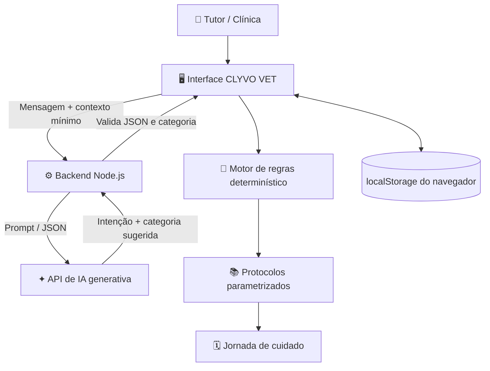

# Arquitetura — CLYVO VET Sprint 4

## Responsabilidades
- **Interface:** captura mensagem do tutor e exibe o resultado.
- **Backend Node.js:** protege a chave, valida a entrada, chama a API e valida a saída.
- **API de IA generativa:** interpreta linguagem natural e sugere uma categoria de acompanhamento.
- **Motor de regras:** determina os protocolos existentes, prioridade e prazo; não delega essas decisões livres ao LLM.
- **localStorage:** persiste pets, análises e jornadas no navegador. Não é um banco remoto.
- **Clínica/veterinário:** permanece responsável por decisões clínicas.

## Segurança
A chave de API é lida pelo backend a partir do arquivo .env; não é enviada ao navegador. O servidor entrega publicamente apenas index.html e arquivos estáticos da pasta assets/, não o arquivo de segredos nem o código do servidor. O backend restringe tamanho da mensagem, categorias permitidas e formato esperado. Falhas da API retornam erro claro sem apresentar resultado fictício.

## Limitações honestas
A API externa é usada quando a aplicação está configurada com uma chave válida e um modelo habilitado. A persistência segue local. Não existe integração com prontuário clínico ou banco remoto nesta versão. A API configurada precisa ser compatível com o formato Chat Completions.
